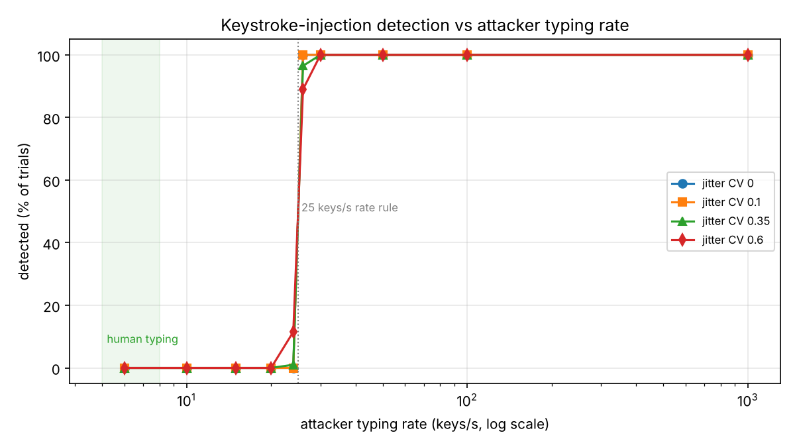

# Evasion experiment: what it costs an attacker to slip past keystroke-injection detection

```bash
python -m server.evasion --plot docs/evasion.png     # the deployed detector
python -m server.evasion --hardened                  # two candidate countermeasures (not deployed)
```

**Question.** TraceForge flags a newly connected keyboard that types faster or more regularly than a
person (`usb_keystroke_injection.yml`). An attacker who knows the rule can adapt. How far must they
go to evade it, and what does that cost them?

**Method.** A 300-keystroke payload (a typical one-line PowerShell download-and-run command) is "typed"
by three adaptive strategies, 200 randomised trials per setting. Only the attacker's key timing is
simulated: everything detection-related is TraceForge's real code (the agent's timing summary and its
30-second watch window, then the Sigma rule). Gaps between keys are log-normal with a chosen mean and
coefficient of variation (CV: 0 = a metronome, about 0.3-0.6 = human irregularity).



## Results (deployed detector)

| Strategy | Result | Cheapest evasion | Payload time | vs undetected attack (1.3 s) |
| --- | --- | --- | --- | --- |
| **Slow down** | Caught at 26+ keys/s; evades below 25 keys/s, even with no jitter at all | 24 keys/s | 13.4 s | 10x slower |
| **Chunk** (fast bursts + `DELAY`) | Never evades: caught in 98-100% of trials for every burst size and pause tested | none | | |
| **Wait** out the watch window | Caught up to 29.9 s; evades if typing starts 30 s or more after plug-in | wait 30 s | 30.3 s | 23x slower |

Findings:

1. **The burst condition works.** Splitting the payload into fast bursts with pauses, the classic
   Rubber Ducky `STRING` / `DELAY` pattern, is caught every time, whatever the burst size. Without the
   burst condition (the rule as it was before this project's fix: rate and regularity tests only), 8 of
   these 10 settings evaded detection completely; only bursts of 10-20 keys with short pauses were fast
   enough overall to trip the rate test.
2. **The cheapest evasion is to type at just under 25 keys/s.** That is about 3-4x faster than a fast
   human typist, so an attacker does not need to type at human speed. A 300-key payload takes 13.4 s instead
   of 1.3 s. That is 10x slower, but still far faster than a person.
3. **Perfect regularity below 25 keys/s also evades**, because the "too regular" test only applies when
   the median gap is under 30 ms. A metronome at 24 keys/s is plainly a machine, yet it passes.
4. **Waiting 30 s after plug-in defeats the watch entirely.** It is the easiest evasion to program
   (`DELAY 30000`) and costs only half a minute.

## Candidate countermeasures (measured, not deployed)

`--hardened` adds a "metronome" test (15+ keys with gap CV under 0.1 is a machine at any speed) and a
300-second watch window:

| Strategy | Deployed | Hardened |
| --- | --- | --- |
| Metronome at 6-24 keys/s (CV 0) | evades | **caught (100%)** |
| Slight jitter (CV 0.1) at 6-24 keys/s | evades | caught 42-50% |
| Human-like jitter (CV 0.35-0.6) at < 25 keys/s | evades | **still evades** |
| Wait out the window | 30 s | **301 s** (232x slower) |

They are not switched on yet. A longer window also lengthens the time in which a person holding down a
key on a newly connected keyboard (auto-repeat, about 30 keys/s on Windows by default) could be mistaken
for injection, so they need testing on real hardware first.

## Conclusion

Timing-based detection has a floor: **anything that looks like a fast human, just under 25 keys/s with
human-like irregularity, passes**, and no threshold change fixes that without flagging real fast typists.
What the detector does achieve is to force the attacker off the default tooling (Ducky speed, `DELAY`
bursts) into a custom, jittered, ~10x slower payload, and with the countermeasures to wait minutes rather
than seconds. Either way the attack takes longer and is more likely to be noticed by a person at the machine.

That is why TraceForge does not rely on typing alone. The same device is also judged when it connects:
a programmable attack board's IDs (`programmable_hid_board`, NIST High) open an incident before it types a
key, and a board that copies a real keyboard's IDs is still a never-seen device (`unknown_device`), whose
descriptor fingerprint is compared with known units of the model it claims (`descriptor_model_mismatch`).
The evasion result is the argument for that layered design.

## Limitations

- Simulated timings. Real boards add USB polling jitter (1-8 ms per report), which would only make the
  fastest settings look slightly less regular; validating with a Digispark or Arduino Pro Micro is future work.
- One payload length. Shorter payloads give the rules fewer keys (15 is the minimum), so very short
  commands are easier to slip through.
- The rate test measures keys over the typing span. An attacker who types one fast burst and then
  nothing is covered by the burst test, which is why chunking never evades.
